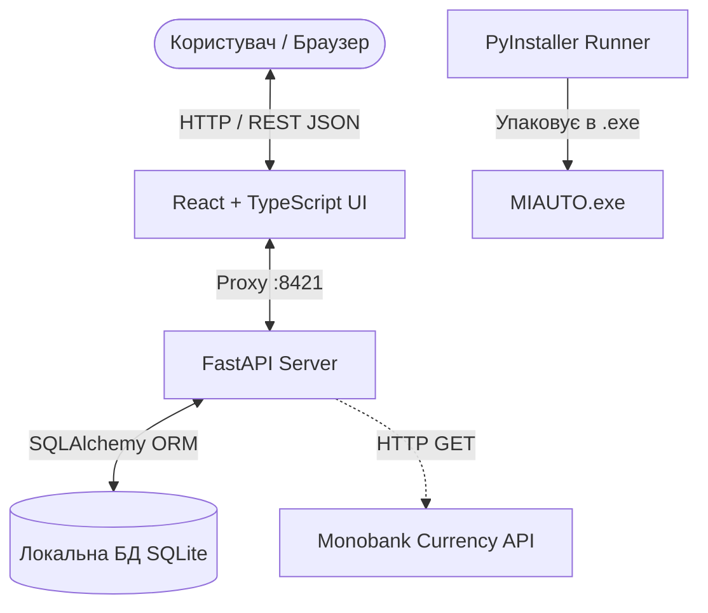

# Архітектура системи (System Architecture) — MIAUTO

## 1. Загальний огляд системи

MIAUTO побудовано за гібридною клієнт-серверною архітектурою, яка упаковується в автономний настільний додаток (Standalone Executable) для ОС Windows.

---

## 2. Основні компоненти

### 2.1. Бекенд (API Server)
* **Фреймворк:** FastAPI (Python 3.11).
* **ASGI Сервер:** Uvicorn (вбудований у рантайм додатку, слухає `127.0.0.1:8421`).
* **Моделі даних:** SQLAlchemy 2.0 декларативні моделі (`Client`, `Order`, `OrderItem`, `Supplier`).
* **Валідація та серіалізація:** Pydantic v2 схеми (`app/schemas/`).
* **Маршрутизація:** Модульні роутери для замовлень, клієнтів, аналітики дашборду, курсів валют та налаштувань.

### 2.2. Фронтенд (Користувацький інтерфейс)
* **Стек:** React 19, TypeScript, Vite.
* **Стилізація:** Vanilla CSS, компоненти за принципами Material Design.
* **Таблиці:** `@tanstack/react-table` для швидкого сортування, пагінації та фільтрації великих списків запчастин.
* **Локалізація (i18n):** `i18next` та `react-i18next` (підтримка української та російської мов).

### 2.3. Сховище даних (Data Layer)
* **СУБД:** SQLite 3 у файловому режимі WAL (Write-Ahead Logging).
* **Розташування:**
  * У режимі розробки: `backend/data/miauto.db`.
  * У скомпільованому `.exe`: каталог `data/miauto.db` поруч із виконуваним файлом.
* **Міграції:** Легкі автоматичні міграції та перевірка схеми під час ініціалізації (`app/database.py`).

---

## 3. Потоки даних (Data Flow)

1. **Ініціалізація застосунку:**
   * PyInstaller запускає точку входу `backend/app/main.py`.
   * Перевіряється наявність каталогу `data/` та створюються таблиці бази даних SQLite (якщо файл відсутній).
   * Запускається сервер Uvicorn на порті 8421.
   * Застосунок автоматично відкриває стандартний системний браузер за адресою `http://127.0.0.1:8421`.
2. **Створення замовлення:**
   * Клієнтська частина відправляє POST запит на `/api/orders`.
   * Pydantic валідує структуру даних, суми та валюту.
   * ORM зберігає замовлення та позиції в межах транзакції.
   * Оновлюється баланс клієнта та історія розрахунків.

---

## 4. Межі довіри та безпека (Trust Boundaries)

* **Мережева ізоляція:** Сервер прив'язується виключно до петлі зворотного зв'язку (`127.0.0.1`), що унеможливлює підключення з локальної мережі без використання спеціалізованих тунелів.
* **Зовнішні залежності:** Єдиний зовнішній вихідний запит здійснюється до публічного API Monobank для оновлення курсу валют (з таймаутом та fallback на локальний кеш у разі відсутності інтернету).
* **Секрети:** Застосунок не зберігає критичних хмарних ключів доступу у відкритому вигляді.
