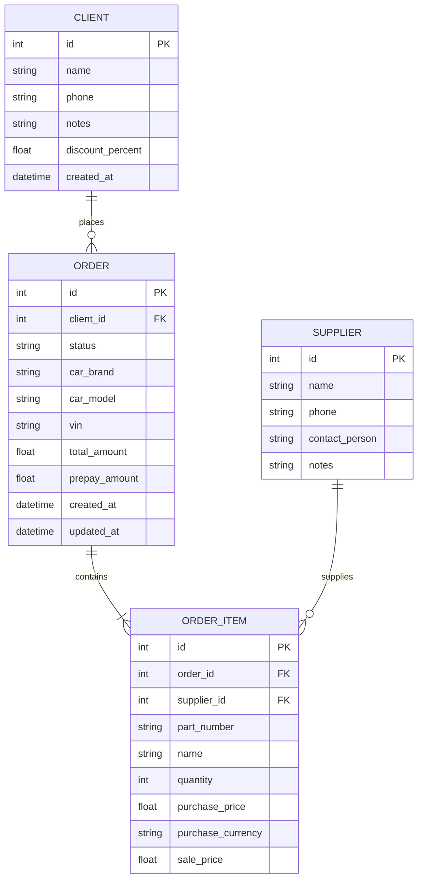

# Структура бази даних (Database Schema) — MIAUTO

## 1. Загальні відомості

* **СУБД:** SQLite 3.
* **Режим журналу:** WAL (Write-Ahead Logging) для забезпечення паралельного читання без блокування.
* **ORM:** SQLAlchemy 2.0 (`DeclarativeBase`).
* **Модуль підключення та міграцій:** `backend/app/database.py`.

---

## 2. Діаграма сутностей (ER Diagram)

---

## 3. Таблиці та їх призначення

### 3.1. `clients` (Клієнти)
Зберігає контактні дані покупців, знижки та історію взаємодії.
* `id` (INTEGER, PK, autoincrement)
* `name` (VARCHAR, обов'язкове)
* `phone` (VARCHAR, обов'язкове, індексоване)
* `notes` (TEXT, необов'язкове)
* `discount_percent` (FLOAT, за замовчуванням 0.0)
* `created_at` (DATETIME, за замовчуванням CURRENT_TIMESTAMP)

### 3.2. `orders` (Замовлення)
Основна сутність обліку угод із клієнтами.
* `id` (INTEGER, PK, autoincrement)
* `client_id` (INTEGER, FK -> `clients.id`, обов'язкове)
* `status` (VARCHAR, статуси: `NEW`, `IN_PROGRESS`, `WAITING_PARTS`, `READY`, `COMPLETED`, `CANCELLED`)
* `car_brand` / `car_model` / `vin` (VARCHAR, інформація про автомобіль)
* `total_amount` (FLOAT, розрахункова підсумкова вартість у гривні)
* `prepay_amount` (FLOAT, сума внесеної передплати)
* `created_at` / `updated_at` (DATETIME)

### 3.3. `order_items` (Позиції замовлення)
Конкретні автозапчастини в замовленні.
* `id` (INTEGER, PK, autoincrement)
* `order_id` (INTEGER, FK -> `orders.id`, CASCADE on delete)
* `supplier_id` (INTEGER, FK -> `suppliers.id`, NULLable)
* `part_number` (VARCHAR, артикул деталі)
* `name` (VARCHAR, назва запчастини)
* `quantity` (INTEGER, кількість штук)
* `purchase_price` (FLOAT, закупівельна ціна)
* `purchase_currency` (VARCHAR, валюта закупівлі: `UAH`, `USD`, `EUR`)
* `sale_price` (FLOAT, ціна продажу клієнту в гривні)

### 3.4. `suppliers` (Постачальники)
Каталог постачальників автозапчастин із контактною інформацією.
* `id` (INTEGER, PK, autoincrement)
* `name` (VARCHAR, обов'язкове)
* `phone` (VARCHAR)
* `contact_person` (VARCHAR)
* `notes` (TEXT)

---

## 4. Механізм міграцій (Migrations)

У проекті використовується легкий механізм інспекції та міграції схеми при старті додатку (`app/database.py`):
1. Метод `init_db()` створює всі відсутні таблиці за допомогою `Base.metadata.create_all(bind=engine)`.
2. За допомогою `inspect(engine)` перевіряються нові стовпці в існуючих таблицях SQLite та виконуються `ALTER TABLE ADD COLUMN` у разі їх відсутності.
