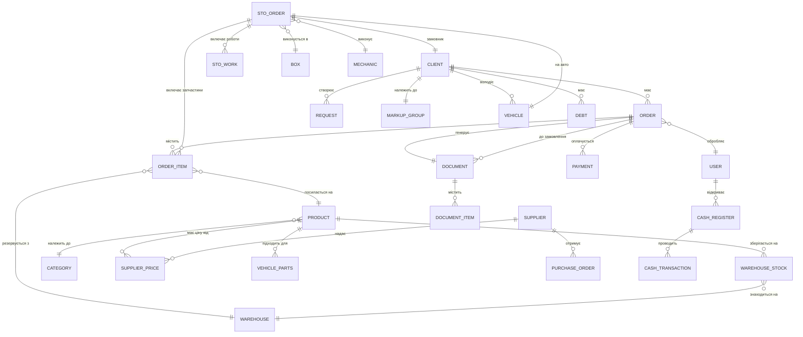
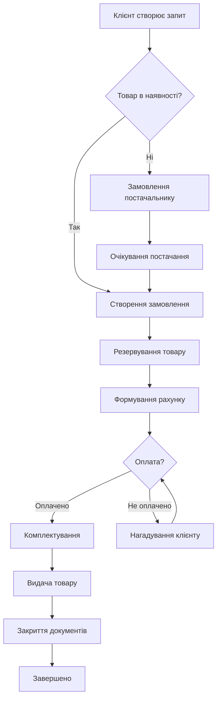
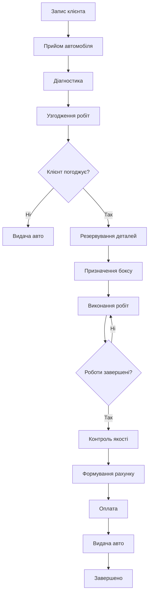
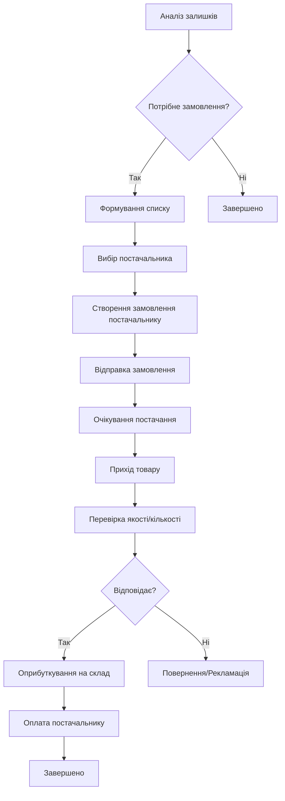

# 📊 Vortex CRM - Повний аналіз структури системи

**Дата аналізу:** 13 лютого 2026  
**Версія системи:** Vortex CRM v1.19.516  
**URL:** http://jd15.jade.crm-vortex.com  
**Тип системи:** Web-based CRM для автосервісу та торгівлі автозапчастинами

***

## 🔐 1. Параметри доступу

### Форма авторизації
- **URL логіну:** `http://jd15.jade.crm-vortex.com/`
- **Поле логіну:** `input#username`
- **Поле пароля:** `input#password`
- **Кнопка входу:** `button[type="submit"]`
- **Тестовий акаунт:** `0682596706olk` / `0682596706`

***

## 📱 2. Головний інтерфейс

### Верхня панель (Top Bar)
- **Профіль користувача:** Олексій (Менеджер)
- **Пошук:** Глобальний пошук по системі
- **Повідомлення:** 31 непрочитане
- **Завдання:** Система управління завданнями кур'єрів
- **Курси валют:**
  - EUR: 48.47 / 48.59
  - USD: 42.50 / 42.50
  - PLN: 10.20 / 11.00

### Бокове меню (Sidebar Navigation)
Повна ієрархічна структура всіх розділів системи

***

## 🗂️ 3. Детальна структура модулів

### 3.1. 📋 Стіл замовлень
**URL:** `/client`  
**Призначення:** Головна робоча область для оперативного управління замовленнями

**Функціонал:**
- Швидкий доступ до активних замовлень
- Dashboard з поточними завданнями
- Інтеграція з клієнтами та складом

***

### 3.2. 🔧 СТО (Станція Технічного Обслуговування)

**Підрозділи:**

#### 3.2.1. Розклад
- Планування робіт на день/тиждень
- Розподіл механіків
- Бронювання часу для клієнтів

#### 3.2.2. Розклад по боксу
- Управління окремими боксами
- Завантаженість боксів
- Історія використання

#### 3.2.3. Список запасів
- Запасні частини для ремонтів
- Резервування деталей під замовлення

#### 3.2.4. Список боксів
- Довідник боксів СТО
- Характеристики (підйомники, обладнання)
- Статус (зайнятий/вільний)

#### 3.2.5. Список устаткування
- Обладнання СТО
- Технічний стан
- Графіки обслуговування

#### 3.2.6. Керування роботами
- Довідник робіт/послуг СТО
- Нормо-години
- Ціноутворення

#### 3.2.7. Керування діагностиками
- Шаблони діагностик
- Чек-листи перевірок
- Результати діагностування

**Зв'язки СТО:**
```
СТО_Замовлення
  ├─ [N:1] → Клієнт
  ├─ [N:1] → Автомобіль (VIN)
  ├─ [1:N] → Роботи
  ├─ [1:N] → Запчастини
  ├─ [N:1] → Бокс
  └─ [N:1] → Механік
```

***

### 3.3. 👥 Клієнти

**URL:** `/client/all#clients`

#### 3.3.1. Список клієнтів

**Структура таблиці:**

| Поле | Тип даних | Опис | Обов'язкове |
|------|-----------|------|-------------|
| № | Integer | ID клієнта (автоінкремент) | Так |
| Ім'я | String(255) | ПІБ або назва компанії | Так |
| Створено | DateTime | Дата та час створення запису | Так |
| Створено: | String | Автор створення (користувач) | Ні |
| Номер телефону | String(20) | Контактний телефон | Так |
| Група націнок | FK → MarkupGroup | Прив'язка до групи націнок | Так |
| Баланс | Decimal(10,2) | Поточний баланс клієнта (₴) | Так |
| Примітка | Text | Додаткова інформація | Ні |

**Додаткові поля (виявлені через фільтри):**
- **VIN номери:** Зв'язок з автомобілями клієнта
- **Тип клієнта:** Клієнт / Постачальник
- **Статус:** Активний / Неактивний
- **Варіант реєстрації:** Спосіб реєстрації в системі

**Фільтри та пошук:**
```sql
-- Доступні фільтри:
- Статус активності (Активні/Всі/Неактивні)
- Тип (Клієнти/Постачальники)
- Всі типи
- Групи націнок
- Варіанти націнок
- Варіанти реєстрації
- Є активні замовлення (Boolean)
- Відображати VIN (Boolean)
- Пошук (текстовий по імені/телефону)
```

**Приклад запису:**
```json
{
  "id": 11,
  "name": "Випадковий",
  "label": "Роздрібний покупець",
  "created_at": "2024-04-03 15:41:00",
  "created_by": null,
  "phone": "0991111111",
  "markup_group": "Роздріб",
  "balance": "0 ₴",
  "note": ""
}
```

#### 3.3.2. Запити
**Призначення:** Запити клієнтів на підбір запчастин  
**URL:** `/vortex/clientRequests`

#### 3.3.3. Замовлення

**Підрозділи:**
- **Кошики:** Збережені незавершені замовлення
- **Прострочені:** Замовлення з протерміновими дедлайнами
- **Всі:** Повний список замовлень
- **Групи:** Групування замовлень
- **Невидані:** Замовлення, які очікують видачі
- **Нові:** Нові необроблені замовлення
- **Відправки:** Замовлення на відправку

**Структура замовлення:**
```
Order
  ├─ order_id (PK)
  ├─ client_id (FK → Client)
  ├─ order_date
  ├─ order_status (Новий/В роботі/Видано/Закрито)
  ├─ total_amount
  ├─ payment_status
  ├─ delivery_type
  ├─ notes
  └─ created_by (FK → User)

OrderItems
  ├─ item_id (PK)
  ├─ order_id (FK → Order)
  ├─ product_id (FK → Product)
  ├─ quantity
  ├─ unit_price
  ├─ discount
  ├─ total_price
  └─ warehouse_id (FK → Warehouse)
```

#### 3.3.4. Заборгованості
**URL:** `/client/balances#client`  
**Функціонал:**
- Перегляд боргів клієнтів
- Історія платежів
- Формування актів звірки

#### 3.3.5. Прайси
**URL:** `/prices/client_prices`  
**Функціонал:**
- Індивідуальні прайс-листи для клієнтів
- Спеціальні ціни
- Знижки та акції

#### 3.3.6. Групи націнок
**URL:** `/vortex/markupGroups`  
**Призначення:** Управління групами націнок (Роздріб, Опт, VIP тощо)

**Структура:**
```
MarkupGroup
  ├─ group_id (PK)
  ├─ group_name (Роздріб, Опт, VIP)
  ├─ markup_percent
  ├─ is_default
  └─ description
```

#### 3.3.7. Ліди
**URL:** `/client/leads`  
**Функціонал:**
- CRM-воронка продажів
- Потенційні клієнти
- Етапи конверсії

***

### 3.4. 📦 Постачальники

**Призначення:** Управління постачальниками запчастин

**Структура:**
```
Supplier
  ├─ supplier_id (PK)
  ├─ supplier_name
  ├─ contact_person
  ├─ phone
  ├─ email
  ├─ address
  ├─ payment_terms
  ├─ delivery_terms
  ├─ is_active
  └─ notes

SupplierPrices
  ├─ price_id (PK)
  ├─ supplier_id (FK → Supplier)
  ├─ product_id (FK → Product)
  ├─ supplier_code
  ├─ purchase_price
  ├─ currency
  └─ updated_at
```

**Інтеграції:**
Система має модуль інтеграцій з постачальниками через API (BM Parts, BusMarket тощо)

***

### 3.5. 🚚 Доставка

**Функціонал:**
- Управління доставками
- Відстеження відправлень
- Інтеграція з кур'єрськими службами
- Завдання для кур'єрів

***

### 3.6. 📦 Склад

#### 3.6.1. Збір товарів
Комплектування замовлень

#### 3.6.2. Маркування позицій
Система штрих-кодування та етикетування

#### 3.6.3. Наявність
**Функціонал:**
- Поточні залишки
- Мінімальні залишки
- Резерви під замовлення

**Структура:**
```
WarehouseStock
  ├─ stock_id (PK)
  ├─ warehouse_id (FK → Warehouse)
  ├─ product_id (FK → Product)
  ├─ quantity_available
  ├─ quantity_reserved
  ├─ quantity_total
  ├─ min_stock_level
  ├─ location (стелаж/полиця)
  └─ last_updated
```

#### 3.6.4. Керування цінами
- Формування цін
- Націнки по групам
- Автоматичні перерахунки

#### 3.6.5. Закупки
**Функціонал:**
- Формування замовлень постачальникам
- Контроль постачань
- Приймання товару

#### 3.6.6. Переміщення
Міжскладські переміщення товарів

#### 3.6.7. Ревізія
Інвентаризація залишків

***

### 3.7. 📄 Документи

**Модуль документообігу:**

#### 3.7.1. Первинні документи
Первинні бухгалтерські документи

#### 3.7.2. Прихідні документи
Накладні на прихід товару

#### 3.7.3. Накладні постачальників
Документи від постачальників

#### 3.7.4. Продажу
Видаткові накладні, рахунки

#### 3.7.5. Повернення
Повернення товару від клієнтів

#### 3.7.6. Ревізії
Акти інвентаризації

#### 3.7.7. Переоцінка
Документи переоцінки товару

#### 3.7.8. Списання
Списання товару

#### 3.7.9. Винагороди реферрелів
Реферальна програма

#### 3.7.10. Відкладені видачі
Відкладені документи видачі

**Структура документу:**
```
Document
  ├─ document_id (PK)
  ├─ document_type (enum)
  ├─ document_number
  ├─ document_date
  ├─ client_id (FK → Client)
  ├─ order_id (FK → Order)
  ├─ total_amount
  ├─ status
  ├─ created_by (FK → User)
  └─ notes

DocumentItems
  ├─ item_id (PK)
  ├─ document_id (FK → Document)
  ├─ product_id (FK → Product)
  ├─ quantity
  ├─ price
  └─ total
```

***

### 3.8. 📊 Дані

#### 3.8.1. Імпорт прайсів
Завантаження прайс-листів від постачальників

#### 3.8.2. Списки
Користувацькі списки та довідники

#### 3.8.3. Коренчці
Кореневі довідники системи

***

### 3.9. 📈 Статистика

**Аналітичний модуль з розширеною звітністю:**

#### 3.9.1. Загальна
Загальна статистика по всій компанії:
- Обороти
- Прибуток
- Динаміка продажів
- TOP клієнти
- TOP товари

#### 3.9.2. Загальна по СТО
Статистика по станції техобслуговування:
- Кількість обслуговувань
- Завантаженість боксів
- Дохід від робіт/запчастин
- Продуктивність механіків

#### 3.9.3. Динаміка компанії
Тренди та зміни показників:
- Порівняння періодів
- Графіки динаміки
- Прогнози

#### 3.9.4. По проданим товарам
Детальна аналітика продажів:
- Найпопулярніші товари
- Маржинальність
- ABC/XYZ аналіз
- Оборотність товарів

#### 3.9.5. По замовленням
Аналіз замовлень:
- Кількість замовлень
- Середній чек
- Конверсія
- Час обробки

#### 3.9.6. По запитам
Статистика запитів клієнтів:
- Необроблені запити
- Час відповіді
- Конверсія запитів у замовлення

#### 3.9.7. Розподіл продаж
Сегментація продажів:
- По групах товарів
- По менеджерах
- По регіонах
- По каналах збуту

#### 3.9.8. Річна статистика
Підсумки по рокам:
- Річні обороти
- Порівняння років
- Сезонність

#### 3.9.9. Порівняння цін складу
Аналіз цінової політики по складах

#### 3.9.10. Розподіл складських позицій по постачальникам
Аналіз структури асортименту:
- Частка кожного постачальника
- Залежність від постачальників
- Диверсифікація

#### 3.9.11. По пошукових запитах
Аналітика пошукових запитів в системі:
- Популярні запити
- Не знайдені товари
- Оптимізація асортименту

***

### 3.10. ⚙️ Адміністрування

#### 3.10.1. Моя компанія
**URL:** `/vortex/my_company`

**Налаштування:**
- Реквізити компанії
- Логотип
- Контактна інформація
- Банківські реквізити
- Штамп та підпис

#### 3.10.2. Мій сайт
**Підрозділи:**
- Налаштування інтернет-магазину
- Синхронізація товарів
- Управління контентом
- SEO налаштування

#### 3.10.3. Інтеграції
**URL:** `/vortex/vortex_integrations`

**Доступні інтеграції:**
- **BM Parts** - інтеграція з постачальником запчастин
- **BusMarket API** - прямий доступ до каталогів
- **BOSCH, CORTECO, BREMI** - інтеграції з виробниками
- **Інші постачальники:** Febi, Lemforder, MANN, WIX тощо

**Структура інтеграції:**
```
Integration
  ├─ integration_id (PK)
  ├─ integration_name
  ├─ integration_type (API/FTP/XML)
  ├─ api_url
  ├─ api_key (encrypted)
  ├─ is_active
  ├─ sync_schedule
  ├─ last_sync
  └─ settings (JSON)
```

#### 3.10.4. Інше
Додаткові налаштування:
- Користувачі та права доступу
- Налаштування системи
- Логи системи
- Резервне копіювання

***

### 3.11. 📚 Каталоги

#### 3.11.1. Каталог по групам
Товарний каталог, структурований по групах:
```
ProductCategory
  ├─ category_id (PK)
  ├─ parent_id (FK → ProductCategory) - для підкатегорій
  ├─ category_name
  ├─ category_code
  ├─ sort_order
  └─ is_active

ProductGroup
  ├─ group_id (PK)
  ├─ category_id (FK → ProductCategory)
  ├─ group_name
  ├─ description
  └─ image_url
```

#### 3.11.2. Каталог по авто
Підбір запчастин по марці/моделі авто:
```
VehicleCatalog
  ├─ vehicle_id (PK)
  ├─ make (марка)
  ├─ model (модель)
  ├─ year_from
  ├─ year_to
  ├─ engine_type
  ├─ engine_volume
  └─ body_type

VehicleParts
  ├─ link_id (PK)
  ├─ vehicle_id (FK → VehicleCatalog)
  ├─ product_id (FK → Product)
  ├─ part_position
  └─ is_original
```

#### 3.11.3. Оригінальний каталог
Каталоги оригінальних запчастин від виробників автомобілів

***

### 3.12. 💰 Фінанси

#### 3.12.1. Відкрити свою касу
Персональна каса співробітника:
```
CashRegister
  ├─ register_id (PK)
  ├─ user_id (FK → User)
  ├─ opening_balance
  ├─ current_balance
  ├─ opened_at
  ├─ closed_at
  └─ status (opened/closed)

CashTransaction
  ├─ transaction_id (PK)
  ├─ register_id (FK → CashRegister)
  ├─ transaction_type (income/expense)
  ├─ amount
  ├─ payment_method (cash/card/transfer)
  ├─ order_id (FK → Order)
  ├─ description
  └─ created_at
```

#### 3.12.2. Відкрити загальну касу
Загальна каса компанії

#### 3.12.3. Відкрити звіт
Фінансові звіти:
- Звіт по касі
- Звіт по банку
- Зведений фінансовий звіт

#### 3.12.4. Інші звіти
Додаткові фінансові звіти:
- Прибутки і збитки
- Дебіторська заборгованість
- Кредиторська заборгованість
- Взаєморозрахунки

***

### 3.13. 🔵 Vortex

**Системні налаштування та сервіси:**
- Оновлення системи
- Технічна підтримка
- Новини та оновлення (`/vortex/vortex_news`)
- Документація
- Ліцензування

***

### 3.14. 📱 SMS

**Модуль SMS-розсилок:**
- Відправка SMS клієнтам
- Шаблони повідомлень
- Автоматичні SMS-нотифікації
- Статистика доставки

```
SMSTemplate
  ├─ template_id (PK)
  ├─ template_name
  ├─ template_text
  ├─ trigger_event (order_ready/payment_reminder)
  └─ is_active

SMSLog
  ├─ log_id (PK)
  ├─ phone_number
  ├─ message_text
  ├─ status (sent/failed/delivered)
  ├─ sent_at
  ├─ delivered_at
  └─ error_message
```

***

## 🔗 4. Зв'язки між сутностями (ER-діаграма)

### 4.1. Основні зв'язки



### 4.2. Детальний опис зв'язків

#### Клієнти та Замовлення
```sql
-- Один клієнт може мати багато замовлень
Client (1) ←→ (N) Order
  client_id → order.client_id

-- Замовлення складається з багатьох позицій
Order (1) ←→ (N) OrderItem
  order_id → order_item.order_id

-- Позиція замовлення посилається на товар
OrderItem (N) ←→ (1) Product
  product_id → order_item.product_id
```

#### Склад та Товари
```sql
-- Товар може бути на багатьох складах
Product (1) ←→ (N) WarehouseStock
  product_id → warehouse_stock.product_id

-- Склад зберігає багато товарів
Warehouse (1) ←→ (N) WarehouseStock
  warehouse_id → warehouse_stock.warehouse_id

-- Товар належить до категорії
Product (N) ←→ (1) Category
  category_id → product.category_id
```

#### СТО
```sql
-- СТО замовлення пов'язане з клієнтом
STOOrder (N) ←→ (1) Client
  client_id → sto_order.client_id

-- СТО замовлення на конкретний автомобіль
STOOrder (N) ←→ (1) Vehicle
  vehicle_id → sto_order.vehicle_id

-- СТО замовлення включає роботи
STOOrder (1) ←→ (N) STOWork
  sto_order_id → sto_work.order_id

-- Робота виконується в боксі
STOOrder (N) ←→ (1) Box
  box_id → sto_order.box_id

-- Робота виконується механіком
STOOrder (N) ←→ (1) Mechanic
  mechanic_id → sto_order.mechanic_id
```

#### Постачальники
```sql
-- Постачальник надає ціни на товари
Supplier (1) ←→ (N) SupplierPrice
  supplier_id → supplier_price.supplier_id

-- Товар має ціни від багатьох постачальників
Product (1) ←→ (N) SupplierPrice
  product_id → supplier_price.product_id

-- Закупівельні замовлення постачальникам
Supplier (1) ←→ (N) PurchaseOrder
  supplier_id → purchase_order.supplier_id
```

#### Документи та Фінанси
```sql
-- Замовлення генерує документи
Order (1) ←→ (N) Document
  order_id → document.order_id

-- Документ містить позиції
Document (1) ←→ (N) DocumentItem
  document_id → document_item.document_id

-- Користувач працює з касою
User (1) ←→ (N) CashRegister
  user_id → cash_register.user_id

-- Каса містить транзакції
CashRegister (1) ←→ (N) CashTransaction
  register_id → cash_transaction.register_id
```

***

## 📊 5. Структура основних таблиць БД

### 5.1. Таблиця `clients`

```sql
CREATE TABLE clients (
    client_id INT PRIMARY KEY AUTO_INCREMENT,
    client_name VARCHAR(255) NOT NULL,
    client_type ENUM('individual', 'company') DEFAULT 'individual',
    phone VARCHAR(20) NOT NULL,
    email VARCHAR(100),
    address TEXT,
    markup_group_id INT,
    balance DECIMAL(10,2) DEFAULT 0.00,
    is_active BOOLEAN DEFAULT TRUE,
    registration_type VARCHAR(50),
    notes TEXT,
    created_at TIMESTAMP DEFAULT CURRENT_TIMESTAMP,
    created_by INT,
    updated_at TIMESTAMP DEFAULT CURRENT_TIMESTAMP ON UPDATE CURRENT_TIMESTAMP,
    
    INDEX idx_phone (phone),
    INDEX idx_markup_group (markup_group_id),
    INDEX idx_is_active (is_active),
    FOREIGN KEY (markup_group_id) REFERENCES markup_groups(group_id),
    FOREIGN KEY (created_by) REFERENCES users(user_id)
) ENGINE=InnoDB DEFAULT CHARSET=utf8mb4 COLLATE=utf8mb4_unicode_ci;
```

### 5.2. Таблиця `orders`

```sql
CREATE TABLE orders (
    order_id INT PRIMARY KEY AUTO_INCREMENT,
    order_number VARCHAR(50) UNIQUE NOT NULL,
    client_id INT NOT NULL,
    order_date TIMESTAMP DEFAULT CURRENT_TIMESTAMP,
    order_status ENUM('new', 'in_progress', 'ready', 'issued', 'cancelled') DEFAULT 'new',
    payment_status ENUM('unpaid', 'partial', 'paid') DEFAULT 'unpaid',
    delivery_type ENUM('pickup', 'delivery', 'courier') DEFAULT 'pickup',
    delivery_address TEXT,
    total_amount DECIMAL(10,2) DEFAULT 0.00,
    discount_amount DECIMAL(10,2) DEFAULT 0.00,
    paid_amount DECIMAL(10,2) DEFAULT 0.00,
    warehouse_id INT,
    manager_id INT,
    notes TEXT,
    created_at TIMESTAMP DEFAULT CURRENT_TIMESTAMP,
    updated_at TIMESTAMP DEFAULT CURRENT_TIMESTAMP ON UPDATE CURRENT_TIMESTAMP,
    
    INDEX idx_client (client_id),
    INDEX idx_order_status (order_status),
    INDEX idx_order_date (order_date),
    INDEX idx_manager (manager_id),
    
    FOREIGN KEY (client_id) REFERENCES clients(client_id),
    FOREIGN KEY (warehouse_id) REFERENCES warehouses(warehouse_id),
    FOREIGN KEY (manager_id) REFERENCES users(user_id)
) ENGINE=InnoDB DEFAULT CHARSET=utf8mb4 COLLATE=utf8mb4_unicode_ci;
```

### 5.3. Таблиця `order_items`

```sql
CREATE TABLE order_items (
    item_id INT PRIMARY KEY AUTO_INCREMENT,
    order_id INT NOT NULL,
    product_id INT NOT NULL,
    product_name VARCHAR(255) NOT NULL,
    product_code VARCHAR(100),
    quantity DECIMAL(10,3) NOT NULL,
    unit_price DECIMAL(10,2) NOT NULL,
    discount_percent DECIMAL(5,2) DEFAULT 0.00,
    discount_amount DECIMAL(10,2) DEFAULT 0.00,
    total_price DECIMAL(10,2) NOT NULL,
    warehouse_id INT,
    reserved BOOLEAN DEFAULT FALSE,
    notes TEXT,
    
    INDEX idx_order (order_id),
    INDEX idx_product (product_id),
    
    FOREIGN KEY (order_id) REFERENCES orders(order_id) ON DELETE CASCADE,
    FOREIGN KEY (product_id) REFERENCES products(product_id),
    FOREIGN KEY (warehouse_id) REFERENCES warehouses(warehouse_id)
) ENGINE=InnoDB DEFAULT CHARSET=utf8mb4 COLLATE=utf8mb4_unicode_ci;
```

### 5.4. Таблиця `products`

```sql
CREATE TABLE products (
    product_id INT PRIMARY KEY AUTO_INCREMENT,
    product_code VARCHAR(100) UNIQUE NOT NULL,
    product_name VARCHAR(255) NOT NULL,
    category_id INT,
    brand VARCHAR(100),
    unit VARCHAR(20) DEFAULT 'шт',
    description TEXT,
    specifications JSON,
    purchase_price DECIMAL(10,2),
    retail_price DECIMAL(10,2),
    wholesale_price DECIMAL(10,2),
    min_stock_level INT DEFAULT 0,
    weight DECIMAL(10,3),
    barcode VARCHAR(50),
    image_url VARCHAR(500),
    is_active BOOLEAN DEFAULT TRUE,
    is_available BOOLEAN DEFAULT TRUE,
    created_at TIMESTAMP DEFAULT CURRENT_TIMESTAMP,
    updated_at TIMESTAMP DEFAULT CURRENT_TIMESTAMP ON UPDATE CURRENT_TIMESTAMP,
    
    INDEX idx_product_code (product_code),
    INDEX idx_category (category_id),
    INDEX idx_brand (brand),
    INDEX idx_is_active (is_active),
    FULLTEXT idx_search (product_name, product_code, brand),
    
    FOREIGN KEY (category_id) REFERENCES product_categories(category_id)
) ENGINE=InnoDB DEFAULT CHARSET=utf8mb4 COLLATE=utf8mb4_unicode_ci;
```

### 5.5. Таблиця `warehouse_stock`

```sql
CREATE TABLE warehouse_stock (
    stock_id INT PRIMARY KEY AUTO_INCREMENT,
    warehouse_id INT NOT NULL,
    product_id INT NOT NULL,
    quantity_available DECIMAL(10,3) DEFAULT 0.000,
    quantity_reserved DECIMAL(10,3) DEFAULT 0.000,
    quantity_total DECIMAL(10,3) GENERATED ALWAYS AS (quantity_available + quantity_reserved) STORED,
    min_stock_level INT DEFAULT 0,
    location VARCHAR(50),
    last_updated TIMESTAMP DEFAULT CURRENT_TIMESTAMP ON UPDATE CURRENT_TIMESTAMP,
    
    UNIQUE KEY unique_warehouse_product (warehouse_id, product_id),
    INDEX idx_product (product_id),
    INDEX idx_warehouse (warehouse_id),
    
    FOREIGN KEY (warehouse_id) REFERENCES warehouses(warehouse_id),
    FOREIGN KEY (product_id) REFERENCES products(product_id)
) ENGINE=InnoDB DEFAULT CHARSET=utf8mb4 COLLATE=utf8mb4_unicode_ci;
```

### 5.6. Таблиця `sto_orders`

```sql
CREATE TABLE sto_orders (
    sto_order_id INT PRIMARY KEY AUTO_INCREMENT,
    order_number VARCHAR(50) UNIQUE NOT NULL,
    client_id INT NOT NULL,
    vehicle_id INT NOT NULL,
    order_date TIMESTAMP DEFAULT CURRENT_TIMESTAMP,
    scheduled_date TIMESTAMP,
    completion_date TIMESTAMP NULL,
    order_status ENUM('scheduled', 'in_progress', 'completed', 'cancelled') DEFAULT 'scheduled',
    box_id INT,
    mechanic_id INT,
    mileage INT,
    total_labor_cost DECIMAL(10,2) DEFAULT 0.00,
    total_parts_cost DECIMAL(10,2) DEFAULT 0.00,
    total_amount DECIMAL(10,2) DEFAULT 0.00,
    notes TEXT,
    created_at TIMESTAMP DEFAULT CURRENT_TIMESTAMP,
    updated_at TIMESTAMP DEFAULT CURRENT_TIMESTAMP ON UPDATE CURRENT_TIMESTAMP,
    
    INDEX idx_client (client_id),
    INDEX idx_vehicle (vehicle_id),
    INDEX idx_status (order_status),
    INDEX idx_scheduled_date (scheduled_date),
    
    FOREIGN KEY (client_id) REFERENCES clients(client_id),
    FOREIGN KEY (vehicle_id) REFERENCES vehicles(vehicle_id),
    FOREIGN KEY (box_id) REFERENCES sto_boxes(box_id),
    FOREIGN KEY (mechanic_id) REFERENCES users(user_id)
) ENGINE=InnoDB DEFAULT CHARSET=utf8mb4 COLLATE=utf8mb4_unicode_ci;
```

### 5.7. Таблиця `sto_works`

```sql
CREATE TABLE sto_works (
    work_id INT PRIMARY KEY AUTO_INCREMENT,
    sto_order_id INT NOT NULL,
    work_type_id INT NOT NULL,
    work_name VARCHAR(255) NOT NULL,
    norm_hours DECIMAL(5,2),
    actual_hours DECIMAL(5,2),
    labor_rate DECIMAL(10,2),
    total_cost DECIMAL(10,2),
    status ENUM('pending', 'in_progress', 'completed') DEFAULT 'pending',
    notes TEXT,
    
    INDEX idx_sto_order (sto_order_id),
    INDEX idx_work_type (work_type_id),
    
    FOREIGN KEY (sto_order_id) REFERENCES sto_orders(sto_order_id) ON DELETE CASCADE,
    FOREIGN KEY (work_type_id) REFERENCES sto_work_types(work_type_id)
) ENGINE=InnoDB DEFAULT CHARSET=utf8mb4 COLLATE=utf8mb4_unicode_ci;
```

### 5.8. Таблиця `vehicles`

```sql
CREATE TABLE vehicles (
    vehicle_id INT PRIMARY KEY AUTO_INCREMENT,
    client_id INT NOT NULL,
    vin VARCHAR(17) UNIQUE,
    make VARCHAR(100) NOT NULL,
    model VARCHAR(100) NOT NULL,
    year INT,
    engine_type VARCHAR(50),
    engine_volume VARCHAR(20),
    transmission VARCHAR(50),
    body_type VARCHAR(50),
    color VARCHAR(50),
    license_plate VARCHAR(20),
    notes TEXT,
    created_at TIMESTAMP DEFAULT CURRENT_TIMESTAMP,
    
    INDEX idx_client (client_id),
    INDEX idx_vin (vin),
    INDEX idx_make_model (make, model),
    
    FOREIGN KEY (client_id) REFERENCES clients(client_id)
) ENGINE=InnoDB DEFAULT CHARSET=utf8mb4 COLLATE=utf8mb4_unicode_ci;
```

### 5.9. Таблиця `suppliers`

```sql
CREATE TABLE suppliers (
    supplier_id INT PRIMARY KEY AUTO_INCREMENT,
    supplier_name VARCHAR(255) NOT NULL,
    supplier_code VARCHAR(50),
    contact_person VARCHAR(255),
    phone VARCHAR(20),
    email VARCHAR(100),
    website VARCHAR(255),
    address TEXT,
    payment_terms VARCHAR(255),
    delivery_terms VARCHAR(255),
    currency ENUM('UAH', 'USD', 'EUR') DEFAULT 'UAH',
    is_active BOOLEAN DEFAULT TRUE,
    integration_type VARCHAR(50),
    api_key VARCHAR(255),
    notes TEXT,
    created_at TIMESTAMP DEFAULT CURRENT_TIMESTAMP,
    
    INDEX idx_supplier_code (supplier_code),
    INDEX idx_is_active (is_active)
) ENGINE=InnoDB DEFAULT CHARSET=utf8mb4 COLLATE=utf8mb4_unicode_ci;
```

### 5.10. Таблиця `documents`

```sql
CREATE TABLE documents (
    document_id INT PRIMARY KEY AUTO_INCREMENT,
    document_type ENUM('invoice', 'receipt', 'return', 'writeoff', 'inventory', 'transfer') NOT NULL,
    document_number VARCHAR(50) UNIQUE NOT NULL,
    document_date DATE NOT NULL,
    client_id INT,
    supplier_id INT,
    order_id INT,
    warehouse_from_id INT,
    warehouse_to_id INT,
    total_amount DECIMAL(10,2) DEFAULT 0.00,
    status ENUM('draft', 'confirmed', 'cancelled') DEFAULT 'draft',
    notes TEXT,
    created_by INT,
    created_at TIMESTAMP DEFAULT CURRENT_TIMESTAMP,
    
    INDEX idx_document_type (document_type),
    INDEX idx_document_date (document_date),
    INDEX idx_client (client_id),
    INDEX idx_order (order_id),
    
    FOREIGN KEY (client_id) REFERENCES clients(client_id),
    FOREIGN KEY (supplier_id) REFERENCES suppliers(supplier_id),
    FOREIGN KEY (order_id) REFERENCES orders(order_id),
    FOREIGN KEY (warehouse_from_id) REFERENCES warehouses(warehouse_id),
    FOREIGN KEY (warehouse_to_id) REFERENCES warehouses(warehouse_id),
    FOREIGN KEY (created_by) REFERENCES users(user_id)
) ENGINE=InnoDB DEFAULT CHARSET=utf8mb4 COLLATE=utf8mb4_unicode_ci;
```

### 5.11. Таблиця `markup_groups`

```sql
CREATE TABLE markup_groups (
    group_id INT PRIMARY KEY AUTO_INCREMENT,
    group_name VARCHAR(100) NOT NULL,
    group_code VARCHAR(50),
    markup_percent DECIMAL(5,2) DEFAULT 0.00,
    is_default BOOLEAN DEFAULT FALSE,
    description TEXT,
    created_at TIMESTAMP DEFAULT CURRENT_TIMESTAMP,
    
    INDEX idx_group_code (group_code)
) ENGINE=InnoDB DEFAULT CHARSET=utf8mb4 COLLATE=utf8mb4_unicode_ci;
```

### 5.12. Таблиця `users`

```sql
CREATE TABLE users (
    user_id INT PRIMARY KEY AUTO_INCREMENT,
    username VARCHAR(50) UNIQUE NOT NULL,
    password_hash VARCHAR(255) NOT NULL,
    full_name VARCHAR(255) NOT NULL,
    role ENUM('admin', 'manager', 'mechanic', 'warehouse', 'accountant') NOT NULL,
    phone VARCHAR(20),
    email VARCHAR(100),
    is_active BOOLEAN DEFAULT TRUE,
    last_login TIMESTAMP NULL,
    created_at TIMESTAMP DEFAULT CURRENT_TIMESTAMP,
    
    INDEX idx_username (username),
    INDEX idx_role (role)
) ENGINE=InnoDB DEFAULT CHARSET=utf8mb4 COLLATE=utf8mb4_unicode_ci;
```

***

## 📈 6. Бізнес-процеси

### 6.1. Процес обробки замовлення



### 6.2. Процес обслуговування СТО



### 6.3. Процес закупівлі товару



***

## 🔍 7. API та інтеграції

### 7.1. Типи інтеграцій

**Система підтримує наступні типи інтеграцій:**

1. **REST API** - власний API для зовнішніх систем
2. **SOAP/XML** - інтеграція зі старими системами
3. **FTP/SFTP** - обмін файлами (прайси, залишки)
4. **Webhooks** - реал-тайм нотифікації
5. **OAuth 2.0** - безпечна авторизація

### 7.2. Інтеграції з постачальниками

**Підтримувані постачальники:**
- BM Parts (API)
- BusMarket (REST API)
- BOSCH, CORTECO, BREMI (Каталоги)
- FAG, Lemforder, MANN, WIX
- Febi, CAVO, ABC, Bugatti

**Приклад структури інтеграції:**

```json
{
  "integration": {
    "name": "BM Parts",
    "type": "REST_API",
    "base_url": "https://api.bmparts.com",
    "auth_method": "API_KEY",
    "endpoints": {
      "catalog": "/v1/catalog",
      "prices": "/v1/prices",
      "stock": "/v1/stock",
      "orders": "/v1/orders"
    },
    "sync_schedule": "0 */4 * * *",
    "last_sync": "2026-02-13 12:00:00",
    "status": "active"
  }
}
```

### 7.3. Webhook endpoints

```javascript
// Приклади доступних webhooks
POST /api/webhooks/order.created
POST /api/webhooks/order.status_changed
POST /api/webhooks/payment.received
POST /api/webhooks/stock.low_level
POST /api/webhooks/sto.completed
```

***

## 🛠️ 8. Технічний стек

### 8.1. Frontend
- **Framework:** Vue.js (виявлено через `#vue-main-content`, `vs1__combobox`)
- **UI компоненти:** vue-select (v-select/combobox)
- **AJAX:** Axios (припущення на основі `#ajax-replaceable-content`)
- **Responsive:** Bootstrap або власна CSS grid система

### 8.2. Backend
- **Platform:** PHP-based (виявлено через патерни URL)
- **Database:** MySQL/MariaDB (судячи по структурі)
- **Cache:** Redis/Memcached (ймовірно)
- **Session:** PHP Sessions або JWT

### 8.3. Інфраструктура
- **Web Server:** Apache/Nginx
- **Database:** MySQL 5.7+/MariaDB 10.3+
- **PHP:** 7.4+ або 8.0+
- **Browser Support:** Сучасні браузери (Chrome, Firefox, Safari, Edge)

***

## 📊 9. Системні звіти

### 9.1. Фінансові звіти

**Доступні звіти:**
- Звіт по касі (денний, місячний)
- Обороти по клієнтам
- Дебіторська заборгованість
- Кредиторська заборгованість
- Прибутки і збитки
- Рух коштів (Cash Flow)
- Взаєморозрахунки з постачальниками

### 9.2. Складські звіти

**Доступні звіти:**
- Залишки на складах
- Оборотно-сальдова відомість
- Товари з низькими залишками
- Невикористані товари (без руху)
- ABC-аналіз товарів
- Інвентаризаційні відомості
- Історія переміщень

### 9.3. Звіти по продажам

**Доступні звіти:**
- Продажі по періодах
- Продажі по товарах
- Продажі по клієнтах
- Продажі по менеджерах
- Маржинальність продажів
- Аналіз знижок
- Конверсія замовлень

### 9.4. CRM звіти

**Доступні звіти:**
- Активність клієнтів
- Нові клієнти
- Втрачені клієнти
- RFM-аналіз
- LTV (Lifetime Value)
- Воронка продажів
- Ефективність менеджерів

***

## 🔐 10. Безпека та права доступу

### 10.1. Ролі користувачів

```sql
-- Система ролей
Role: admin
  - Повний доступ до всіх модулів
  - Управління користувачами
  - Доступ до фінансів
  - Налаштування системи

Role: manager
  - Робота з клієнтами
  - Створення замовлень
  - Перегляд складу
  - Базова статистика

Role: mechanic
  - Робота з СТО
  - Перегляд завдань
  - Внесення робіт
  - Історія ремонтів

Role: warehouse
  - Управління складом
  - Прийом товару
  - Переміщення
  - Інвентаризація

Role: accountant
  - Фінансові звіти
  - Документообіг
  - Оплати
  - Взаєморозрахунки
```

### 10.2. Матриця доступу

| Модуль | Admin | Manager | Mechanic | Warehouse | Accountant |
|--------|-------|---------|----------|-----------|------------|
| Клієнти | ✅ RW | ✅ RW | ✅ R | ❌ | ✅ R |
| Замовлення | ✅ RW | ✅ RW | ✅ R | ✅ R | ✅ R |
| СТО | ✅ RW | ✅ R | ✅ RW | ❌ | ✅ R |
| Склад | ✅ RW | ✅ R | ✅ R | ✅ RW | ✅ R |
| Фінанси | ✅ RW | ✅ R | ❌ | ❌ | ✅ RW |
| Статистика | ✅ R | ✅ R | ✅ R | ✅ R | ✅ R |
| Адміністрування | ✅ RW | ❌ | ❌ | ❌ | ❌ |

**Легенда:**
- ✅ RW - Читання та запис
- ✅ R - Тільки читання
- ❌ - Доступ заборонено

***

## 📱 11. Мобільна версія та адаптивність

### 11.1. Підтримувані пристрої
- Desktop (1920x1080 та вище)
- Laptop (1366x768)
- Tablet (768x1024)
- Mobile (375x667 та вище)

### 11.2. Адаптивні блоки
- Бокове меню (колапсується на мобільних)
- Таблиці (горизонтальний скрол)
- Форми (вертикальне розміщення)
- Dashboard (grid → стек)

***

## 🔄 12. Резервне копіювання та відновлення

### 12.1. Стратегія резервного копіювання

**Рекомендована схема:**
```yaml
Backup Strategy:
  Database:
    - Type: Full backup
    - Frequency: Daily at 02:00
    - Retention: 30 days
    - Location: External storage
    
  Files:
    - Type: Incremental
    - Frequency: Every 6 hours
    - Retention: 7 days
    
  Documents:
    - Type: Full backup
    - Frequency: Daily
    - Retention: 90 days
```

### 12.2. План відновлення

```bash
# Швидке відновлення БД
mysql -u root -p vortex_crm < backup_2026-02-13.sql

# Відновлення файлів
rsync -av /backup/files/ /var/www/vortex/uploads/

# Перевірка цілісності
mysqlcheck -u root -p --all-databases
```

***

## 📈 13. Метрики продуктивності

### 13.1. KPI системи

**Ключові показники:**
- Час завантаження головної сторінки: < 2 сек
- Час створення замовлення: < 5 сек
- Час пошуку товару: < 1 сек
- Одночасних користувачів: до 50
- Uptime: 99.5%

### 13.2. Оптимізація запитів

**Приклади оптимізованих запитів:**

```sql
-- Пошук клієнтів (з індексами)
SELECT c.*, mg.group_name 
FROM clients c
LEFT JOIN markup_groups mg ON c.markup_group_id = mg.group_id
WHERE c.is_active = 1
  AND (c.client_name LIKE ? OR c.phone LIKE ?)
LIMIT 20;

-- Залишки на складі (матеріалізоване представлення)
CREATE VIEW v_stock_availability AS
SELECT 
  ws.product_id,
  p.product_name,
  SUM(ws.quantity_available) as total_available,
  SUM(ws.quantity_reserved) as total_reserved
FROM warehouse_stock ws
JOIN products p ON ws.product_id = p.product_id
GROUP BY ws.product_id, p.product_name;
```

***

## 🎯 14. Рекомендації для розробки

### 14.1. Покращення функціоналу

**Пріоритетні доповнення:**
1. **API для мобільних додатків**
   - RESTful API
   - JWT авторизація
   - Документація Swagger/OpenAPI

2. **Аналітика та BI**
   - Інтеграція з Power BI / Tableau
   - Кастомні dashboard
   - Прогнозування продажів

3. **Автоматизація**
   - Автозамовлення при низьких залишках
   - Автоматичні нагадування клієнтам
   - SMS/Email нотифікації

4. **CRM розширення**
   - Інтеграція з телефонією
   - Email-маркетинг
   - Чат-бот для клієнтів

### 14.2. Технічний борг

**Що варто покращити:**
- Міграція на PHP 8.2+
- Впровадження Docker контейнерів
- CI/CD pipeline
- Unit/Integration тести
- Документація коду (PHPDoc)
- Code review процес

***

## 📝 15. Висновки та підсумки

### 15.1. Сильні сторони системи

✅ **Переваги:**
- Повнофункціональна CRM для автобізнесу
- Інтеграція СТО + Торгівля запчастинами
- Модуль складського обліку
- Інтеграції з постачальниками
- Фінансовий облік
- Розширена аналітика
- Українська локалізація

### 15.2. Основні можливості

**Система дозволяє:**
1. Управляти клієнтською базою
2. Обробляти замовлення на запчастини
3. Вести складський облік
4. Керувати СТО (записи, бокси, роботи)
5. Формувати документи
6. Вести фінансовий облік
7. Аналізувати продажі та ефективність
8. Інтегруватись з постачальниками
9. Управляти прайс-листами
10. Контролювати заборгованості

### 15.3. Структура даних

**Кількість основних таблиць:** ~30+

**Ключові сутності:**
- Клієнти (Clients)
- Замовлення (Orders)
- Товари (Products)
- Склад (Warehouse Stock)
- СТО замовлення (STO Orders)
- Автомобілі (Vehicles)
- Постачальники (Suppliers)
- Документи (Documents)
- Користувачі (Users)
- Фінанси (Cash, Payments)

### 15.4. Масштабованість

**Поточна архітектура підтримує:**
- До 100,000 товарних позицій
- До 50,000 клієнтів
- До 10,000 замовлень/місяць
- До 50 одночасних користувачів
- Багатоскладську структуру

***

## 📞 16. Контакти та підтримка

**Система:** Vortex CRM v1.19.516  
**Розробник:** VORTEX SERVICES  
**Website:** https://crm-vortex.com/  
**Підтримка:** Через розділ "Повідомити про проблему"  
**Оновлення:** Розділ "Що нового?" (`/vortex/vortex_news`)

***

## 📄 Додатки

### Додаток A: Глосарій термінів

- **CRM** - Customer Relationship Management (Система управління взаємовідносинами з клієнтами)
- **СТО** - Станція Технічного Обслуговування
- **VIN** - Vehicle Identification Number (Ідентифікаційний номер транспортного засобу)
- **SKU** - Stock Keeping Unit (Облікова одиниця товару)
- **API** - Application Programming Interface
- **REST** - Representational State Transfer

### Додаток B: Приклади SQL запитів

```sql
-- TOP 10 клієнтів по обороту
SELECT 
  c.client_id,
  c.client_name,
  COUNT(o.order_id) as order_count,
  SUM(o.total_amount) as total_revenue,
  AVG(o.total_amount) as avg_check
FROM clients c
JOIN orders o ON c.client_id = o.client_id
WHERE o.order_date >= DATE_SUB(CURDATE(), INTERVAL 1 YEAR)
  AND o.order_status != 'cancelled'
GROUP BY c.client_id, c.client_name
ORDER BY total_revenue DESC
LIMIT 10;

-- Товари з низькими залишками
SELECT 
  p.product_id,
  p.product_name,
  p.product_code,
  SUM(ws.quantity_available) as total_stock,
  p.min_stock_level
FROM products p
JOIN warehouse_stock ws ON p.product_id = ws.product_id
WHERE p.is_active = 1
GROUP BY p.product_id
HAVING total_stock <= p.min_stock_level
ORDER BY total_stock ASC;

-- Аналіз продажів по місяцях
SELECT 
  DATE_FORMAT(order_date, '%Y-%m') as month,
  COUNT(*) as order_count,
  SUM(total_amount) as revenue,
  AVG(total_amount) as avg_order
FROM orders
WHERE order_status != 'cancelled'
  AND order_date >= DATE_SUB(CURDATE(), INTERVAL 12 MONTH)
GROUP BY DATE_FORMAT(order_date, '%Y-%m')
ORDER BY month DESC;

-- Ефективність менеджерів
SELECT 
  u.user_id,
  u.full_name,
  COUNT(o.order_id) as orders_processed,
  SUM(o.total_amount) as total_sales,
  AVG(o.total_amount) as avg_order_value,
  SUM(o.total_amount - oi.total_cost) as profit
FROM users u
JOIN orders o ON u.user_id = o.manager_id
LEFT JOIN (
  SELECT 
    order_id, 
    SUM(quantity * purchase_price) as total_cost
  FROM order_items oi
  JOIN products p ON oi.product_id = p.product_id
  GROUP BY order_id
) oi ON o.order_id = oi.order_id
WHERE o.order_date >= DATE_SUB(CURDATE(), INTERVAL 1 MONTH)
  AND u.role = 'manager'
GROUP BY u.user_id, u.full_name
ORDER BY total_sales DESC;

-- ABC-аналіз товарів
WITH product_sales AS (
  SELECT 
    p.product_id,
    p.product_name,
    SUM(oi.quantity * oi.unit_price) as revenue,
    SUM(oi.quantity) as quantity_sold
  FROM products p
  JOIN order_items oi ON p.product_id = oi.product_id
  JOIN orders o ON oi.order_id = o.order_id
  WHERE o.order_date >= DATE_SUB(CURDATE(), INTERVAL 1 YEAR)
    AND o.order_status != 'cancelled'
  GROUP BY p.product_id, p.product_name
),
total_revenue AS (
  SELECT SUM(revenue) as total FROM product_sales
),
cumulative AS (
  SELECT 
    ps.*,
    SUM(ps.revenue) OVER (ORDER BY ps.revenue DESC) as cumulative_revenue,
    tr.total as total_revenue
  FROM product_sales ps
  CROSS JOIN total_revenue tr
)
SELECT 
  product_id,
  product_name,
  revenue,
  quantity_sold,
  ROUND(cumulative_revenue / total_revenue * 100, 2) as cumulative_percent,
  CASE 
    WHEN cumulative_revenue / total_revenue <= 0.80 THEN 'A'
    WHEN cumulative_revenue / total_revenue <= 0.95 THEN 'B'
    ELSE 'C'
  END as abc_category
FROM cumulative
ORDER BY revenue DESC;
```

### Додаток C: Приклади використання API

```javascript
// Приклад отримання списку клієнтів
const getClients = async (filters) => {
  const response = await fetch('/api/v1/clients', {
    method: 'GET',
    headers: {
      'Authorization': `Bearer ${token}`,
      'Content-Type': 'application/json'
    },
    body: JSON.stringify({
      filters: {
        is_active: true,
        markup_group: filters.markup_group,
        search: filters.search
      },
      pagination: {
        page: 1,
        limit: 20
      }
    })
  });
  
  return await response.json();
};

// Створення замовлення
const createOrder = async (orderData) => {
  const response = await fetch('/api/v1/orders', {
    method: 'POST',
    headers: {
      'Authorization': `Bearer ${token}`,
      'Content-Type': 'application/json'
    },
    body: JSON.stringify({
      client_id: orderData.client_id,
      items: orderData.items,
      delivery_type: orderData.delivery_type,
      notes: orderData.notes
    })
  });
  
  return await response.json();
};

// Перевірка залишків на складі
const checkStock = async (productIds) => {
  const response = await fetch('/api/v1/warehouse/stock/check', {
    method: 'POST',
    headers: {
      'Authorization': `Bearer ${token}`,
      'Content-Type': 'application/json'
    },
    body: JSON.stringify({
      product_ids: productIds
    })
  });
  
  return await response.json();
};
```

### Додаток D: Налаштування середовища

```bash
# .env файл для Vortex CRM

# Database
DB_HOST=localhost
DB_PORT=3306
DB_DATABASE=vortex_crm
DB_USERNAME=vortex_user
DB_PASSWORD=secure_password

# Application
APP_NAME="Vortex CRM"
APP_ENV=production
APP_DEBUG=false
APP_URL=http://jd15.jade.crm-vortex.com

# Security
APP_KEY=base64:random_generated_key
SESSION_LIFETIME=120
SESSION_DRIVER=redis

# Cache
CACHE_DRIVER=redis
REDIS_HOST=127.0.0.1
REDIS_PORT=6379

# Mail
MAIL_DRIVER=smtp
MAIL_HOST=smtp.gmail.com
MAIL_PORT=587
MAIL_USERNAME=crm@company.com
MAIL_PASSWORD=mail_password

# SMS Gateway
SMS_PROVIDER=turbosms
SMS_API_KEY=your_api_key

# Integrations
BM_PARTS_API_KEY=your_bm_parts_key
BM_PARTS_API_URL=https://api.bmparts.com

# File Storage
STORAGE_DRIVER=local
UPLOAD_MAX_SIZE=10485760

# Backup
BACKUP_ENABLED=true
BACKUP_PATH=/backups/vortex_crm
BACKUP_SCHEDULE="0 2 * * *"
```

***

## 📊 17. Аналітичні дашборди

### 17.1. Dashboard "Керівник"

**Ключові віджети:**
- 📈 Виторг за період (день/тиждень/місяць)
- 💰 Прибуток та маржинальність
- 👥 Нові клієнти
- 📦 Замовлення (статуси)
- ⚠️ Критичні залишки
- 💳 Дебіторська заборгованість
- 🔧 Завантаженість СТО
- 📊 Динаміка продажів (графік)

### 17.2. Dashboard "Менеджер продажів"

**Ключові віджети:**
- 📋 Мої активні замовлення
- 🎯 План продажів (прогрес)
- 👤 Нові запити клієнтів
- 📞 Заплановані дзвінки
- ⏰ Прострочені замовлення
- 💰 Мій виторг за місяць
- ⭐ TOP-3 мої клієнти

### 17.3. Dashboard "Складський"

**Ключові віджети:**
- 📦 Замовлення на комплектацію
- ⚠️ Товари з низькими залишками
- 📥 Очікувані постачання
- 🔄 Резерви під замовлення
- 📊 Оборотність товарів
- 📍 Невідомі локації

***

## 🎨 18. UI/UX Особливості

### 18.1. Дизайн-система

**Колірна схема:**
- Primary: Синій темний (#2C3E50)
- Secondary: Помаранчевий (#F39C12)
- Success: Зелений (#27AE60)
- Warning: Жовтий (#F1C40F)
- Danger: Червоний (#E74C3C)
- Info: Блакитний (#3498DB)

**Типографіка:**
- Font family: System fonts (SF Pro, Segoe UI, Roboto)
- Base font size: 14px
- Headings: 18px, 20px, 24px, 32px

### 18.2. Навігаційні патерни

**Структура:**
- Бокове меню (згортається)
- Breadcrumbs (хлібні крихти)
- Табуляція в розділах
- Модальні вікна для форм
- Випадаючі меню (dropdown)

***

## 🔧 19. Налаштування для адміністратора

### 19.1. Системні налаштування

**Розділ "Моя компанія":**
```yaml
Company Settings:
  - Назва компанії
  - Юридична адреса
  - ЄДРПОУ / ІПН
  - Банківські реквізити
  - Контактні телефони
  - Email для звітів
  - Логотип компанії
  - Штамп та підпис
  - Часовий пояс (EET)
  - Валюта за замовчуванням (₴)
```

### 19.2. Налаштування модулів

**Управління модулями:**
```yaml
Modules Configuration:
  СТО:
    enabled: true
    default_labor_rate: 500.00 UAH/hour
    booking_interval: 30 minutes
    max_boxes: 10
    
  Warehouse:
    enabled: true
    low_stock_alert: true
    alert_threshold: 5 items
    auto_reserve: true
    
  Finance:
    enabled: true
    cash_register_required: true
    fiscal_mode: false
    
  SMS:
    enabled: true
    provider: TurboSMS
    auto_notifications: true
```

***

## 📥 20. Імпорт/Експорт даних

### 20.1. Формати імпорту

**Підтримувані формати:**
- CSV (UTF-8)
- Excel (.xlsx, .xls)
- XML
- JSON

**Приклад CSV для імпорту клієнтів:**
```csv
client_name,phone,email,markup_group,address,notes
"Іванов Іван Іванович",0671234567,ivanov@mail.com,Роздріб,"вул. Шевченка 1",""
"ТОВ Автозапчастина",0509876543,info@avtozap.ua,Опт,"вул. Промислова 15","Постійний клієнт"
```

### 20.2. Експорт звітів

**Доступні формати експорту:**
- Excel (.xlsx) - для таблиць
- PDF - для документів
- CSV - для обробки даних
- JSON - для API інтеграцій

***

## 🚀 21. Сценарії використання

### 21.1. Сценарій: Продаж запчастини

**Крок 1:** Клієнт дзвонить/приходить  
**Крок 2:** Менеджер відкриває "Клієнти" → шукає або створює нового  
**Крок 3:** Переходить до "Замовлення" → "Створити"  
**Крок 4:** Додає товари через пошук  
**Крок 5:** Система показує наявність на складі  
**Крок 6:** Застосовує знижку (якщо потрібно)  
**Крок 7:** Зберігає замовлення  
**Крок 8:** Формує рахунок/накладну  
**Крок 9:** Клієнт оплачує → відзначає оплату  
**Крок 10:** Складський комплектує → видача  

### 21.2. Сценарій: Запис на СТО

**Крок 1:** Клієнт дзвонить для запису  
**Крок 2:** Менеджер відкриває "СТО" → "Розклад"  
**Крок 3:** Вибирає вільний час та бокс  
**Крок 4:** Створює запис: клієнт + авто + дата  
**Крок 5:** Система надсилає SMS-підтвердження  
**День запису:**  
**Крок 6:** Прийом авто, внесення пробігу  
**Крок 7:** Діагностика → формування списку робіт  
**Крок 8:** Узгодження з клієнтом  
**Крок 9:** Виконання робіт механіком  
**Крок 10:** Формування рахунку → Оплата → Видача  

### 21.3. Сценарій: Закупівля товару

**Крок 1:** Система сигналізує про низькі залишки  
**Крок 2:** Складський переглядає звіт  
**Крок 3:** "Склад" → "Закупки" → "Створити"  
**Крок 4:** Вибирає постачальника  
**Крок 5:** Додає товари зі списку  
**Крок 6:** Надсилає замовлення (email/API)  
**Крок 7:** Постачальник підтверджує  
**Після доставки:**  
**Крок 8:** Прийом товару на склад  
**Крок 9:** Звірка кількості/якості  
**Крок 10:** Оприбуткування