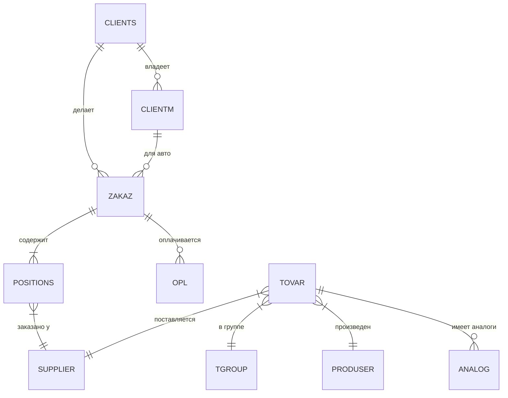

# Структура базы данных MIAUTO

Этот документ описывает схему базы данных, восстановленную на основе анализа экспортированных SQL-дампов и PDF-документации.

## 1. Обзор основных сущностей

Система построена вокруг классической схемы учета автозапчастей:

- **Клиенты** (`CLIENTS`) владеют **Автомобилями** (`CLIENTM`).
- Клиенты делают **Заказы** (`ZAKAZ`).
- В заказах есть **Позиции** (`POSITIONS`), которые ссылаются на товары или заказываются у поставщиков.
- **Склад** (`TOVAR`) хранит номенклатуру, разбитую по **Группам** (`TGROUP`) и **Производителям** (`PRODUSER`).
- **Финансы** отражены в таблицах Оплат (`OPL`) и Платежей поставщикам (`PAYMENT`).

---

## 2. Детальное описание таблиц

### 2.1. ZAKAZ (Заказы)

Центральная таблица операций.

- **PK**: `ZAKAZN` (Integer)
- **Связи**:
  - `CLIENT_ID` -> `CLIENTS.CLIENT_ID` (Кто заказал)
  - `CLIENTM_ID` -> `CLIENTM.CLIENTM_ID` (На какую машину)
- **Ключевые поля**:
  - `DATAZ`: Дата заказа.
  - `SUMM`: Общая сумма заказа.
  - `DOLG`: Долг по заказу.
  - `ZAKAZ_ACTIVE`: Активен ли заказ (BOOL).
  - `ZAKAZ_FINALDATE`: Дата завершения.

### 2.2. POSITIONS (Позиции заказа)

Содержит строки заказа (конкретные детали).

- **PK**: `POSITIONS_ID` (Integer)
- **Связи**:
  - `ZAKAZN` -> `ZAKAZ.ZAKAZN` (К какому заказу относится)
  - `SUPLIER_ID` -> `SUPPLIER.SUPLIER_ID` (Поставщик детали)
- **Ключевые поля**:
  - `KOD`: Артикул детали.
  - `NAME`: Название детали.
  - `COUNTS`: Количество.
  - `PRICEZ`: Цена закупки (?).
  - `PRICEP`: Цена продажи.
  - `PRODUSER`: Производитель (текстом, или связь).
  - `PRIHOD_DATE`, `SALE_DATE`: Даты прихода и продажи.

### 2.3. CLIENTS (Клиенты)

Справочник покупателей.

- **PK**: `CLIENT_ID`
- **Поля**: `FIO`, `PHONE`, `DISCCARD` (скидочная карта), `INN`, `DISCOUNT` (персональная скидка).
- Есть поля для Web-доступа (`WWW_ACCESS`, `WWW_NICKNAME`, `WWW_PASSW`), что говорит о наличии личного кабинета.

### 2.4. CLIENTM (Автомобили клиентов)

Гараж клиента.

- **PK**: `CLIENTM_ID`
- **Связи**:
  - `CLIENT_ID` -> `CLIENTS.CLIENT_ID`
- **Поля**: `VIN`, `MODEL` (Модель), `SUBMODEL`, `GOSNOMER`, `ENGINEV` (Объем двигателя), `ENGINETYPE`.

### 2.5. TOVAR (Склад / Номенклатура)

Справочник товаров и наличие.

- **PK**: `TOVAR_ID`
- **Связи**:
  - `TGROUP_ID` -> `TGROUP.TGROUP_ID` (Категория/Группа)
  - `PRODUSER_ID` -> `PRODUSER.PRODUSER_ID` (Производитель)
  - `SUPPLIER_ID` -> `SUPPLIER.SUPLIER_ID` (Основной поставщик)
- **Поля**: `KOD`, `NAME`, `COUNTS` (Остаток?), `PRICE` (Цена), `PLACE` (Место на складе).

### 2.6. ANALOG (Кроссы / Аналоги)

Таблица связей аналогичных товаров.

- **PK**: `ANALOG_ID`
- **Связи**:
  - `TOVAR_ID` -> `TOVAR.TOVAR_ID`
- **Поля**: `ANAME` - строка с аналогами (вероятно, список номеров через разделитель).

### 2.7. OPL (Платежи от клиентов)

Касса / Оплаты по заказам.

- **PK**: `OPL_N`
- **Связи**:
  - `ZAKAZN` -> `ZAKAZ.ZAKAZN`
- **Поля**: `OPL_SUMM` (Сумма), `OPL_DATE` (Дата), `OPERATION` (Тип операции).

---

## 3. Схема связей (ER-Diagram Concept)

## 4. Рекомендации по миграции

1.  **Типы данных**: В исходной базе (Firebird/Interbase) используются специфичные типы (`DOUBLE PRECISION`, `SMALLINT`, `CHAR(1)` для булевых).
    - При переносе в PostgreSQL/MySQL:
      - `DOUBLE PRECISION` -> `DECIMAL` или `NUMERIC` для денег (важно для точности).
      - `CHAR(1)` (BOOL) -> `BOOLEAN`.
      - `BLOB` (если есть) -> `TEXT` или `BYTEA`.

2.  **Очистка данных**:
    - Таблицы `ANALOG` содержат поле `ANAME`, где перечислено множество аналогов в одной строке (`04491-26;0K2JA...`). Для современной БД это нужно нормализовать: создать отдельную таблицу связи `PRODUCT_CROSS_REFERENCE` (Товар А <-> Товар Б).
    - Проверить кодировку (была `cp1251`, при конвертации в CSV мы перевели в `utf-8`).

3.  **Приложение**:
    - База данных спроектирована грамотно для учета запчастей. Есть разделение на номенклатуру (`TOVAR`) и строки заказа (`POSITIONS`), что позволяет продавать как со склада, так и "под заказ".
    - Есть готовая структура для Web-кабинета (поля `WWW_...` в клиентах).

---

_Документ автоматически сгенерирован на основе анализа файлов SQL и PDF._
