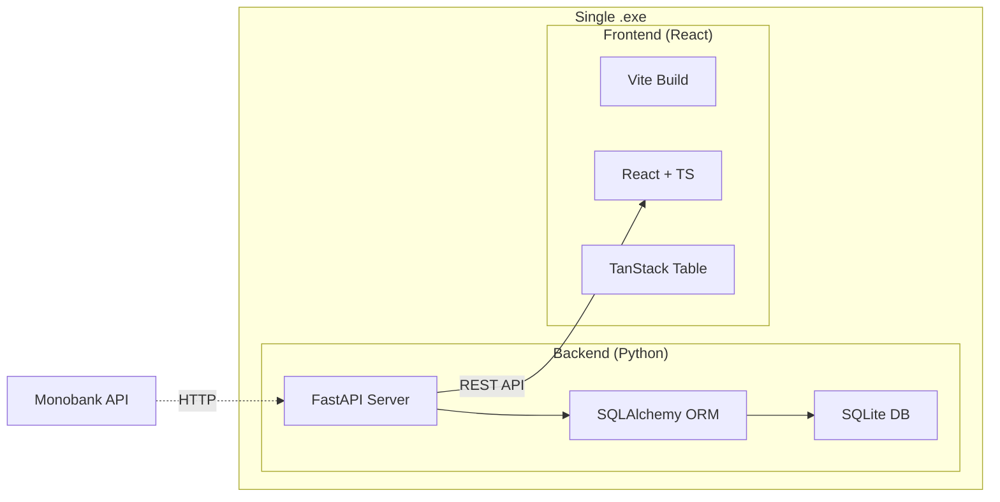
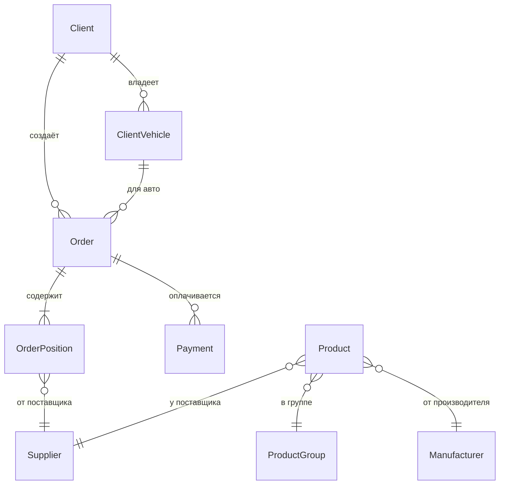

# MIAUTO v1.0 — Стол заказов автозапчастей

## Цель

Создать десктопное веб-приложение для учёта заказов автозапчастей, которое:
- Заменяет устаревшую Firebird-систему
- Импортирует исторические данные из 30 CSV-файлов (~4100 заказов, ~12K позиций, ~1125 клиентов)
- Предоставляет современный UI, вдохновлённый Vortex CRM
- Упаковывается в единый `.exe` для Windows 11

---

## User Review Required

> [!IMPORTANT]
> **Scope MVP vs Full:** План описывает MVP (Стол заказов). Модули СТО, Склад, Документооборот из Vortex CRM **не включены** в первую версию. Подтвердите, что это правильный объём.

> [!WARNING]
> **База данных SQLite:** Для однопользовательского десктоп-приложения SQLite оптимален. Если планируется многопользовательский режим — нужен PostgreSQL. Подтвердите выбор.

> [!IMPORTANT]
> **Курсы валют:** План включает интеграцию с Monobank API (бесплатный, без ключа). Нужны ли дополнительные источники (НБУ, ПриватБанк)?

---

## Архитектура



| Слой | Технология | Версия |
|------|-----------|--------|
| Backend | Python + FastAPI + SQLAlchemy + Pydantic | 3.11+ / 0.100+ / 2.0+ |
| Frontend | React + TypeScript + Vite | 18+ / 5+ / 5+ |
| Таблицы | TanStack Table | v8 |
| БД | SQLite | 3.x |
| Сборка | PyInstaller | 6+ |

---

## Proposed Changes

### 1. Структура проекта

#### [NEW] Корневая структура

```
MIAUTO/
├── backend/
│   ├── app/
│   │   ├── __init__.py
│   │   ├── main.py              # FastAPI app, static files mount
│   │   ├── config.py            # Settings (DB path, API urls)
│   │   ├── database.py          # SQLAlchemy engine + session
│   │   ├── models/              # SQLAlchemy models
│   │   │   ├── __init__.py
│   │   │   ├── client.py        # Client, ClientVehicle
│   │   │   ├── order.py         # Order, OrderPosition
│   │   │   ├── product.py       # Product, ProductGroup, Manufacturer
│   │   │   ├── supplier.py      # Supplier
│   │   │   ├── payment.py       # Payment
│   │   │   └── user.py          # User
│   │   ├── schemas/             # Pydantic schemas
│   │   │   ├── __init__.py
│   │   │   ├── client.py
│   │   │   ├── order.py
│   │   │   ├── product.py
│   │   │   ├── supplier.py
│   │   │   └── payment.py
│   │   ├── routers/             # API endpoints
│   │   │   ├── __init__.py
│   │   │   ├── clients.py
│   │   │   ├── orders.py
│   │   │   ├── products.py
│   │   │   ├── suppliers.py
│   │   │   ├── payments.py
│   │   │   ├── currency.py      # Exchange rates
│   │   │   └── dashboard.py     # Stats / Summary
│   │   ├── services/            # Business logic
│   │   │   ├── __init__.py
│   │   │   ├── currency_service.py
│   │   │   ├── profit_service.py
│   │   │   └── export_service.py
│   │   └── migrations/
│   │       └── import_csv.py    # CSV → SQLite migration script
│   ├── tests/
│   │   ├── test_models.py
│   │   ├── test_api_orders.py
│   │   └── test_import.py
│   └── requirements.txt
├── frontend/
│   ├── src/
│   │   ├── main.tsx
│   │   ├── App.tsx
│   │   ├── api/                 # API client (fetch wrappers)
│   │   ├── components/
│   │   │   ├── layout/          # Header, Sidebar, Footer
│   │   │   ├── orders/          # OrdersTable, OrderForm, OrderCard
│   │   │   ├── clients/         # ClientList, ClientForm, VehicleSelector
│   │   │   ├── common/          # Button, Modal, Input, Select, Badge
│   │   │   └── dashboard/       # CurrencyWidget, StatsCards
│   │   ├── hooks/               # useOrders, useClients, useCurrency
│   │   ├── i18n/                # ua.json, ru.json
│   │   ├── styles/              # index.css, variables.css, theme.css
│   │   └── types/               # TypeScript interfaces
│   ├── package.json
│   ├── vite.config.ts
│   └── tsconfig.json
├── docs/                        # (existing)
├── miauto.spec                  # PyInstaller spec file
└── README.md
```

---

### 2. База данных и модели

#### [NEW] [database.py](file:///d:/Alex/AI/Antigravity/Develop/MIAUTO/backend/app/database.py)

SQLAlchemy 2.0 engine с SQLite, создание сессий.

#### [NEW] [models/client.py](file:///d:/Alex/AI/Antigravity/Develop/MIAUTO/backend/app/models/client.py)

```python
# Маппинг CSV → SQLAlchemy
class Client:                          # ← CLIENTS.csv
    id: int                            # CLIENT_ID
    fio: str                           # FIO
    phone: str                         # PHONE
    inn: str | None                     # INN
    firm: str | None                    # FIRM
    discount: float = 0                # DISCOUNT
    email: str | None                   # EMAIL
    is_bad: bool = False               # BADCLIENT (F→False)
    is_archived: bool = False          # CLIENT_ARCH
    info: str | None                    # INFO
    created_at: datetime

class ClientVehicle:                   # ← CLIENTM.csv
    id: int                            # CLIENTM_ID
    client_id: int → Client.id         # CLIENT_ID
    brand: str                         # MODEL (первое слово: TOYOTA, Nissan...)
    model: str                         # SUBMODEL
    vin: str | None                     # VIN
    license_plate: str | None           # GOSNOMER
    engine_volume: str | None           # ENGINEV
    engine_type: str | None             # ENGINETYPE
    year: str | None                    # AYEAR
    info: str | None                    # INFO
```

#### [NEW] [models/order.py](file:///d:/Alex/AI/Antigravity/Develop/MIAUTO/backend/app/models/order.py)

```python
class Order:                            # ← ZAKAZ.csv
    id: int                             # ZAKAZN
    client_id: int → Client.id          # CLIENT_ID
    vehicle_id: int | None → Vehicle.id # CLIENTM_ID
    date: datetime                      # DATAZ
    currency: str = "грн."              # CUR_NAME
    exchange_rate: float = 1.0          # CUR_CURS
    markup: float = 0                   # NACENKA
    discount: float = 0                 # DISCONT
    total: Decimal                      # SUMM
    debt: Decimal                       # DOLG
    is_active: bool                     # ZAKAZ_ACTIVE (T→True)
    group: str                          # GROUPZ (Клиент/Оплачено/...)
    archive_group: str | None           # ZAKAZ_GROUP
    final_date: datetime | None         # ZAKAZ_FINALDATE
    info: str | None                    # INFO
    author: str | None                  # AUTOR

class OrderPosition:                    # ← POSITIONS.csv
    id: int                             # POSITIONS_ID
    order_id: int → Order.id            # ZAKAZN
    code: str                           # KOD (артикул)
    name: str                           # NAME
    supplier_id: int | None → Supplier  # SUPLIER_ID
    quantity: int                        # COUNTS
    price_purchase: Decimal              # PRICEZ (закупка)
    price_sell: Decimal                  # PRICEP (продажа)
    manufacturer: str | None             # PRODUSER
    condition: str | None                # CONDITION (статус позиции)
    arrival_date: datetime | None        # PRIHOD_DATE
    sale_date: datetime | None           # SALE_DATE
    note: str | None                     # PRIMECHANIE
```

#### [NEW] [models/product.py](file:///d:/Alex/AI/Antigravity/Develop/MIAUTO/backend/app/models/product.py)

```python
class ProductGroup:                     # ← TGROUP.csv
    id: int                             # TGROUP_ID
    name: str                           # TGROUP

class Manufacturer:                     # ← PRODUSER.csv
    id: int                             # PRODUSER_ID
    name: str                           # PRODUSER

class Product:                          # ← TOVAR.csv
    id: int                             # TOVAR_ID
    group_id: int | None → ProductGroup # TGROUP_ID
    manufacturer_id: int | None → Mfr   # PRODUSER_ID
    code: str                           # KOD
    name: str                           # NAME
    stock: int = 0                      # COUNTS
    price: Decimal                      # PRICE
    supplier_id: int | None → Supplier  # SUPPLIER_ID
    location: str | None                # PLACE
```

#### [NEW] [models/supplier.py](file:///d:/Alex/AI/Antigravity/Develop/MIAUTO/backend/app/models/supplier.py)

```python
class Supplier:                         # ← SUPPLIER.csv
    id: int                             # SUPLIER_ID
    name: str                           # SUPLIER
    address: str | None                 # SUPPLIER_ADRESS
    phone: str | None                   # SUPPLIER_PHONE
    contact: str | None                 # SUPPLIER_FIO
    email: str | None                   # SUPPLIER_EMAIL
    delivery_days: int | None           # SUPPLIER_DAYS
```

#### [NEW] [models/payment.py](file:///d:/Alex/AI/Antigravity/Develop/MIAUTO/backend/app/models/payment.py)

```python
class Payment:                          # ← OPL.csv
    id: int                             # OPL_N
    order_id: int → Order.id            # ZAKAZN
    date: datetime                      # OPL_DATE
    amount: Decimal                     # OPL_SUMM
    comment: str | None                 # OPL_COMMENT
    author: str | None                  # OPL_AUTOR
    payment_type: str                   # OPL_VID (Наличные/...)
    operation: str | None               # OPERATION
```

#### ER-диаграмма (новая схема)



---

### 3. Миграция CSV → SQLite

#### [NEW] [migrations/import_csv.py](file:///d:/Alex/AI/Antigravity/Develop/MIAUTO/backend/app/migrations/import_csv.py)

Скрипт импорта данных из `docs/export_orders/coverted_new/*.csv`:

| CSV файл | Целевая модель | Записей | Особенности |
|----------|---------------|---------|-------------|
| CLIENTS.csv | Client | ~1125 | `BADCLIENT`: F→False, T→True |
| CLIENTM.csv | ClientVehicle | ~1295 | Разделить MODEL на brand+model |
| SUPPLIER.csv | Supplier | ~92 | Простой маппинг |
| PRODUSER.csv | Manufacturer | ~220 | Очистка дубликатов регистра |
| TGROUP.csv | ProductGroup | ~many | Иерархия групп |
| TOVAR.csv | Product | ~65K | Большой файл, batch insert |
| ZAKAZ.csv | Order | ~4100 | ZAKAZ_ACTIVE: T→True |
| POSITIONS.csv | OrderPosition | ~12K | FK на Order и Supplier |
| OPL.csv | Payment | ~5500 | Отрицательные суммы = возвраты |

**Порядок импорта** (уважая FK):
1. Suppliers → 2. Manufacturers → 3. ProductGroups → 4. Products → 5. Clients → 6. ClientVehicles → 7. Orders → 8. OrderPositions → 9. Payments

---

### 4. Backend API

#### [NEW] [routers/orders.py](file:///d:/Alex/AI/Antigravity/Develop/MIAUTO/backend/app/routers/orders.py)

| Метод | Endpoint | Описание |
|-------|----------|----------|
| GET | `/api/orders` | Список заказов (пагинация, фильтры, сортировка) |
| GET | `/api/orders/{id}` | Детали заказа с позициями и оплатами |
| POST | `/api/orders` | Создать заказ |
| PUT | `/api/orders/{id}` | Обновить заказ |
| DELETE | `/api/orders/{id}` | Удалить заказ |
| POST | `/api/orders/{id}/positions` | Добавить позицию |
| PUT | `/api/orders/{id}/positions/{pos_id}` | Обновить позицию |
| DELETE | `/api/orders/{id}/positions/{pos_id}` | Удалить позицию |
| POST | `/api/orders/{id}/payments` | Добавить оплату |

#### [NEW] [routers/clients.py](file:///d:/Alex/AI/Antigravity/Develop/MIAUTO/backend/app/routers/clients.py)

| Метод | Endpoint | Описание |
|-------|----------|----------|
| GET | `/api/clients` | Список клиентов (поиск по ФИО/телефону) |
| GET | `/api/clients/{id}` | Клиент + его авто + история заказов |
| POST | `/api/clients` | Создать клиента |
| PUT | `/api/clients/{id}` | Обновить клиента |
| GET | `/api/clients/{id}/vehicles` | Автомобили клиента |
| POST | `/api/clients/{id}/vehicles` | Добавить авто |

#### [NEW] [routers/currency.py](file:///d:/Alex/AI/Antigravity/Develop/MIAUTO/backend/app/routers/currency.py)

| Метод | Endpoint | Описание |
|-------|----------|----------|
| GET | `/api/currency/rates` | Текущие курсы (USD, EUR, PLN) |

Источник: `https://api.monobank.ua/bank/currency` (бесплатный, без ключа, кеш 5 мин)

#### [NEW] [routers/dashboard.py](file:///d:/Alex/AI/Antigravity/Develop/MIAUTO/backend/app/routers/dashboard.py)

| Метод | Endpoint | Описание |
|-------|----------|----------|
| GET | `/api/dashboard/stats` | Активные заказы, общий долг, оборот за месяц |

#### [NEW] [routers/suppliers.py](file:///d:/Alex/AI/Antigravity/Develop/MIAUTO/backend/app/routers/suppliers.py) и [routers/products.py](file:///d:/Alex/AI/Antigravity/Develop/MIAUTO/backend/app/routers/products.py)

CRUD для справочников.

#### [NEW] [services/profit_service.py](file:///d:/Alex/AI/Antigravity/Develop/MIAUTO/backend/app/services/profit_service.py)

Расчёт прибыли по заказу: `Σ(PRICEP - PRICEZ) * COUNTS` для всех позиций.

#### [NEW] [services/export_service.py](file:///d:/Alex/AI/Antigravity/Develop/MIAUTO/backend/app/services/export_service.py)

Экспорт таблицы заказов в XLSX (openpyxl) и CSV.

---

### 5. Frontend — UI

#### Дизайн-система

- **Тема:** Тёмная (по умолчанию) + светлая, переключатель в хедере
- **Палитра:** Синие акценты (`hsl(220, 70%, 55%)`), тёмный фон (`hsl(220, 20%, 10%)`)
- **Типография:** Inter (Google Fonts)
- **Анимации:** Framer Motion для transitions

#### [NEW] Компоненты Layout

| Компонент | Описание |
|-----------|----------|
| `Header` | Логотип MIAUTO, виджет курсов валют (USD/EUR/PLN), переключатели темы и языка (UA/RU) |
| `Sidebar` | Навигация: Заказы, Клиенты, Товары, Поставщики, Настройки |

#### [NEW] Компоненты Orders (Главная страница)

| Компонент | Описание |
|-----------|----------|
| `OrdersTable` | TanStack Table: виртуальная прокрутка, сортировка по всем колонкам, фильтры (статус, дата, клиент), drag&drop колонок, расчёт итогов |
| `OrderForm` | Модальная форма создания/редактирования заказа |
| `OrderCard` | Детальная карточка заказа: позиции, оплаты, прибыль |
| `PositionRow` | Строка позиции: артикул, название, поставщик, кол-во, цена закупки/продажи, маржа |

**Колонки таблицы заказов** (по аналогии с Vortex CRM):

| # | Колонка | Поле | Сортировка |
|---|---------|------|------------|
| 1 | № | id | ✅ |
| 2 | Дата | date | ✅ |
| 3 | Клиент | client.fio | ✅ |
| 4 | Телефон | client.phone | — |
| 5 | Авто | vehicle.brand + model | ✅ |
| 6 | Позиций | positions_count | ✅ |
| 7 | Сумма | total | ✅ |
| 8 | Оплачено | paid | ✅ |
| 9 | Долг | debt | ✅ |
| 10 | Прибыль | profit (вычисляемое) | ✅ |
| 11 | Статус | group | ✅ |

#### [NEW] Компоненты Clients

| Компонент | Описание |
|-----------|----------|
| `ClientList` | Таблица клиентов с поиском |
| `ClientForm` | Форма клиента + выбор/добавление авто |
| `VehicleSelector` | Dropdown с авто клиента (марка, модель, VIN) |

#### [NEW] i18n

Два файла: `ua.json` (українська) и `ru.json` (русский). Переключатель в хедере. Библиотека: `react-i18next`.

---

### 6. Сборка и развёртывание

#### [NEW] [miauto.spec](file:///d:/Alex/AI/Antigravity/Develop/MIAUTO/miauto.spec)

PyInstaller spec:
- Backend + встроенный React build (статика) → один `.exe`
- SQLite база создаётся при первом запуске в `%APPDATA%/MIAUTO/`
- Автооткрытие браузера на `http://localhost:8421`

---

## Verification Plan

### Automated Tests

#### Backend unit tests
```bash
cd d:\Alex\AI\Antigravity\Develop\MIAUTO\backend
python -m pytest tests/ -v
```

Тесты покрывают:
- **test_models.py** — создание моделей, валидация полей, связи FK
- **test_api_orders.py** — CRUD заказов через TestClient (FastAPI)
- **test_import.py** — импорт 5 тестовых записей из каждого CSV, проверка целостности FK

#### Frontend type-check
```bash
cd d:\Alex\AI\Antigravity\Develop\MIAUTO\frontend
npx tsc --noEmit
```

### Browser Tests

1. Запуск dev-сервера и проверка:
   - Таблица заказов рендерится с данными
   - Сортировка по колонке "Сумма" работает
   - Форма создания заказа открывается и валидируется
   - Виджет курсов валют показывает данные

### Manual Verification

1. **Импорт данных:** Запустить `python import_csv.py` — убедиться что все ~4100 заказов, ~12K позиций, ~1125 клиентов загрузились без ошибок
2. **Визуальная проверка:** Открыть приложение в браузере и сравнить с скриншотами Vortex CRM в `docs/pics/`
3. **Пользователь:** Протестировать на чистой Windows 11 после сборки в `.exe`
